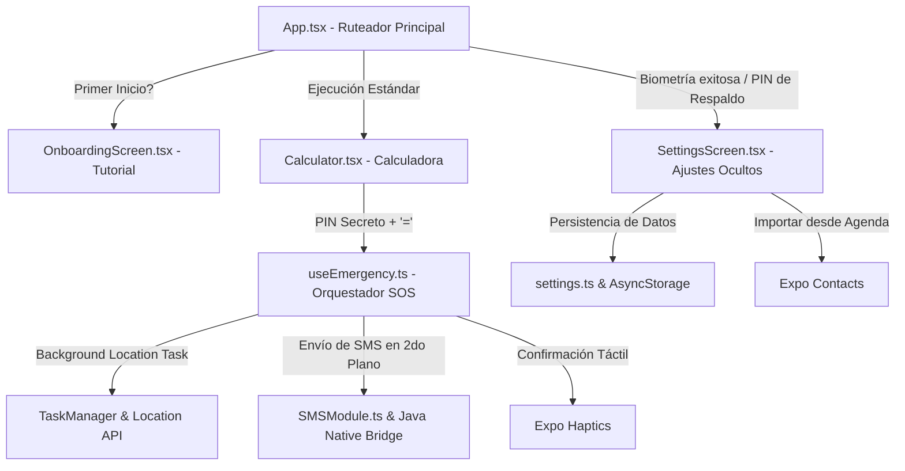

# 📱 CalcuRescue

[](https://expo.dev/)
[](https://reactnative.dev/)
[](https://www.typescriptlang.org/)
[](https://developer.android.com/)
[](https://opensource.org/licenses/MIT)
[](https://github.com/kiramman-mp3/CalcuRescue/releases/latest/download/app-release.apk)

**CalcuRescue** es una aplicación de seguridad personal camuflada bajo la apariencia de una calculadora aritmética real y completamente funcional. Diseñada para proteger a personas en situaciones de alto riesgo o peligro inminente, permite disparar alertas silenciosas de emergencia sin levantar sospechas.

> [!TIP]
> **¿Quieres probar la app en tu teléfono físico?**
> Puedes descargar directamente el archivo instalador APK listo para usar desde la sección de lanzamientos:
> 📦 **[Descargar CalcuRescue APK (Última versión)](https://github.com/kiramman-mp3/CalcuRescue/releases/latest/download/app-release.apk)**

---

## 🛡️ Descripción

### ¿Qué problema resuelve?
En situaciones de peligro como secuestros exprés o violencia de género, intentar abrir la aplicación de mensajería tradicional para pedir ayuda puede poner en riesgo al usuario si el agresor está vigilando. **CalcuRescue** resuelve este problema ofreciendo un medio de auxilio totalmente discreto e inmediato.

### ¿Qué hace?
A primera vista, la aplicación es una calculadora común que permite hacer sumas, restas y operaciones matemáticas reales. Sin embargo, al digitar una clave numérica secreta y presionar el botón `=`, la aplicación ejecuta en segundo plano un protocolo de rescate:
1. Obtiene la ubicación exacta por GPS y calcula el margen de precisión.
2. Lee el nivel de batería del dispositivo para dar contexto a los contactos.
3. Envía mensajes SMS silenciosos en segundo plano a una lista de hasta 5 contactos de confianza configurados previamente, incluyendo un enlace directo a Google Maps.
4. Genera alertas vibratorias táctiles (hápticas) discretas que confirman el envío al tacto del usuario sin emitir ningún sonido ni cambiar la pantalla de la calculadora.

### ¿Para quién está pensado?
Para cualquier persona que requiera un botón de pánico de bolsillo discreto y que no dependa de servidores externos, garantizando una privacidad del 100% y una disponibilidad constante.

---

## ✨ Características

*   **Camuflaje por Marca (Temas):** Permite cambiar el diseño estético de la calculadora entre estilos visuales de **iOS (Apple)**, **Samsung (One UI)** y **Xiaomi (MIUI)** para replicar el estilo de calculadora nativo de tu dispositivo móvil para no sospechar a terceros.
*   **Acceso Secreto Protegido:** El acceso a la pantalla de configuración está protegido con autenticación biométrica (Face ID / Huella digital) y un PIN numérico de respaldo en caso de no tener un acceso biometrico, disparado al mantener presionado el botón `C` por 2 segundos.
*   **Envío de SMS Nativo Silencioso:** Integra un módulo Java nativo para Android que envía SMS directamente sin abrir ventanas de diálogo externas.
*   **Soporte de Doble SIM (Multi-SIM):** El puente nativo resuelve dinámicamente el identificador de suscripción (`subscriptionId`) activo de la tarjeta SIM preferida para SMS, previniendo fallos en dispositivos Dual-SIM.
*   **Geolocalización Ininterrumpida en Segundo Plano:** Utiliza `expo-task-manager` y Foreground Services para crear una notificación persistente de sistema en Android al iniciar el auxilio, asegurando que el hilo de JS no sea suspendido por ahorro de energía, liberando los recursos al terminar.
*   **Consumo de Metadatos Críticos:** Adjunta el nivel de batería actual y la precisión del GPS (en metros) para que tus contactos comprendan la fiabilidad de tu ubicación.
*   **Feedback Háptico Táctil:** Vibraciones codificadas mediante `expo-haptics` (vibración pesada en el gatillo y doble pulsación de éxito/fallo al finalizar) para operar la app en el bolsillo sin ver la pantalla.
*   **Selector de Contactos Integrado:** Modal de búsqueda con filtro en tiempo real integrado con la agenda nativa del dispositivo (`expo-contacts`), que limpia y formatea automáticamente los números telefónicos.
*   **Tutorial de Bienvenida (Onboarding):** Flujo guiado de 5 slides interactivos para educar al usuario sobre los gestos de uso y configurar de forma segura los permisos del sistema.

---

## 🛠️ Tecnologías Utilizadas

*   **Framework Principal:** Expo SDK 54 (React Native 0.81.5)
*   **Lenguajes:** TypeScript (Frontend) & Java (Módulo Nativo de Android)
*   **Almacenamiento Local:** AsyncStorage (Persistencia local encriptada en Sandbox de la app)
*   **Hardware y Sensores:**
    *   `expo-location` (GPS de alta precisión y rastreo en segundo plano)
    *   `expo-battery` (Porcentaje e información de estado de carga)
    *   `expo-haptics` (Control del motor háptico Taptic Engine / vibrador)
    *   `expo-local-authentication` (Biometría nativa)
    *   `expo-contacts` (Acceso a agenda telefónica)

---

## 📐 Arquitectura

El flujo lógico de la aplicación está descentralizado para evitar dependencias con servidores en la nube y asegurar una velocidad óptima de respuesta local:



---

## 📂 Estructura del Proyecto

A continuación se detallan los directorios y archivos principales del proyecto:

```bash
CalcuRescue/
├── android/                   # Directorio de compilación nativa de Android
│   └── app/src/main/
│       ├── java/.../SMSModule.java # Módulo Java nativo para envío de SMS silenciosos
│       └── AndroidManifest.xml # Declaración de permisos del sistema (SMS, GPS, Fondo)
├── assets/                    # Assets estáticos y recursos multimedia de la app
├── src/                       # Código fuente de la aplicación (TypeScript)
│   ├── components/
│   │   └── Calculator.tsx     # Lógica matemática e interceptor del PIN de alerta
│   ├── hooks/
│   │   └── useEmergency.ts    # Orquestador del protocolo de auxilio en primer/segundo plano
│   ├── screens/
│   │   ├── OnboardingScreen.tsx # Tutorial de bienvenida, configuración y permisos
│   │   └── SettingsScreen.tsx # Panel secreto de ajustes y selector de contactos
│   ├── services/
│   │   ├── LocationService.ts # Adaptador para consultas de geolocalización
│   │   └── SMSModule.ts       # Bridge TypeScript para la comunicación con el SMS nativo
│   └── utils/
│       └── settings.ts        # Métodos de lectura y guardado con AsyncStorage
├── App.tsx                    # Componente raíz y control de sesión/bloqueo
├── app.json                   # Configuración del compilador Expo
├── package.json               # Dependencias de npm y scripts del proyecto
└── tsconfig.json              # Configuración de compilación de TypeScript
```

---

## 📋 Requisitos del Sistema

Para compilar y ejecutar el proyecto en tu entorno de desarrollo local, necesitas:

*   **Node.js:** Versión `>= 18.0.0`
*   **Gestor de paquetes:** `npm` o `yarn`
*   **Java Development Kit (JDK):** Versión `17` (obligatorio para Gradle 8.x)
*   **Android Studio:** Configurado con el Android SDK y el SDK Command-line Tools instalado.
*   **Dispositivo de Pruebas:** Se recomienda un teléfono físico Android con tarjeta SIM (chip) activa para validar el envío real de SMS en segundo plano.

---

## 🚀 Instalación y Configuración

Sigue estos pasos para instalar y preparar el entorno local en tu máquina:

1.  **Clonar el repositorio:**
    ```bash
    git clone https://github.com/johan-rodriguez/CalcuRescue.git
    cd CalcuRescue
    ```

2.  **Instalar dependencias:**
    ```bash
    npm install
    ```

3.  **Configurar el SDK de Android:**
    Crea el archivo `android/local.properties` (el cual se encuentra excluido de Git) y define la ruta absoluta del SDK de tu sistema Windows/macOS. Ejemplo en Windows:
    ```properties
    sdk.dir=C\:\\Users\\TU_USUARIO\\AppData\\Local\\Android\\Sdk
    ```

4.  **Configurar el compilador de Java (Gradle):**
    Asegúrate de que la variable `JAVA_HOME` de tu sistema operativo o consola apunte a tu JDK 17 activo. Para compilar con el JDK integrado de Android Studio en PowerShell ejecute:
    ```powershell
    $env:JAVA_HOME="C:\Program Files\Android\Android Studio\jbr"
    ```

---

## 🎮 Uso y Ejecución

### Modo Desarrollo (Metro Bundler)
Para iniciar el empaquetador de Expo y arrancar el servidor Metro de desarrollo:
```bash
npm run start
```

### Compilar y Ejecutar en Android
Para compilar la aplicación nativa de Android, instalarla en el dispositivo conectado por USB e iniciar el debugger:
```bash
npm run android
```

### Compilar y Ejecutar en iOS
Para compilar y arrancar la versión nativa de desarrollo en simuladores iOS (macOS requerido):
```bash
npm run ios
```

---

## 📜 Scripts Disponibles

*   `npm run start`: Inicia el empaquetador de Metro en modo interactivo.
*   `npm run android`: Ejecuta el prebuild nativo y arranca la compilación e instalación del APK de depuración en Android.
*   `npm run ios`: Arranca la compilación de desarrollo en el simulador de iOS de Xcode.
*   `npm run web`: Levanta una versión experimental de la aplicación en el navegador web local.

---

## 🗺️ Roadmap de Funcionalidades

- [x] Migración completa del código legacy de JS a TypeScript estricto.
- [x] Gestión de estado de calculadora mediante `useReducer` centralizado.
- [x] Bloqueo biométrico nativo y fallback con PIN de seguridad.
- [x] Sistema de envío de SMS nativo con soporte Dual-SIM en segundo plano.
- [x] Integración de Foreground Services para evitar suspensiones de geolocalización.
- [x] Historial de importación de contactos mediante agenda nativa y buscador inteligente.
- [x] Temas estéticos por marca (iOS, Samsung y Xiaomi) para camuflaje perfecto.
- [x] Asistente de bienvenida y gestor guiado de permisos (Onboarding).
- [ ] Incorporación de metadatos multimedia en SMS (imagen y audio).
- [ ] Incorporación de un panel de historial local de geolocalizaciones enviadas para el usuario.

---

## 👥 Contribuidores

Lista de contribuidores que han aportado commits al desarrollo de este repositorio:

| Nombre | Commits |
| :--- | :--- |
| **Johan Rodríguez** | 45 |

---

## 📄 Licencia

Este proyecto está bajo la Licencia MIT. Consulta el archivo [LICENSE](LICENSE) para obtener más detalles.

---

## ✍️ Autor

*   **Johan Rodríguez** - *Desarrollador Principal y Arquitecto de Software*
